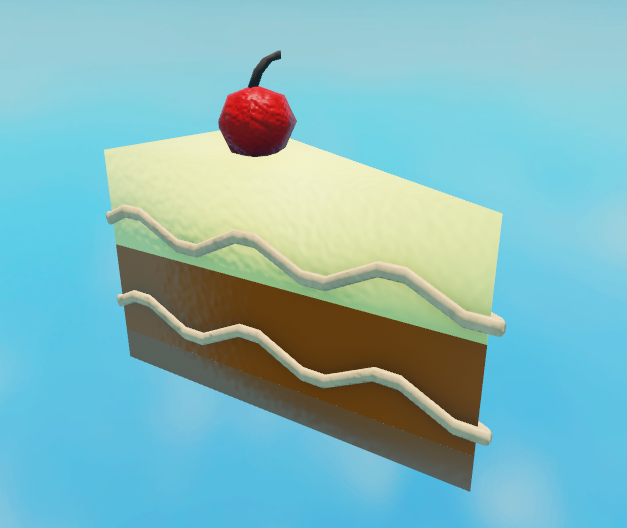
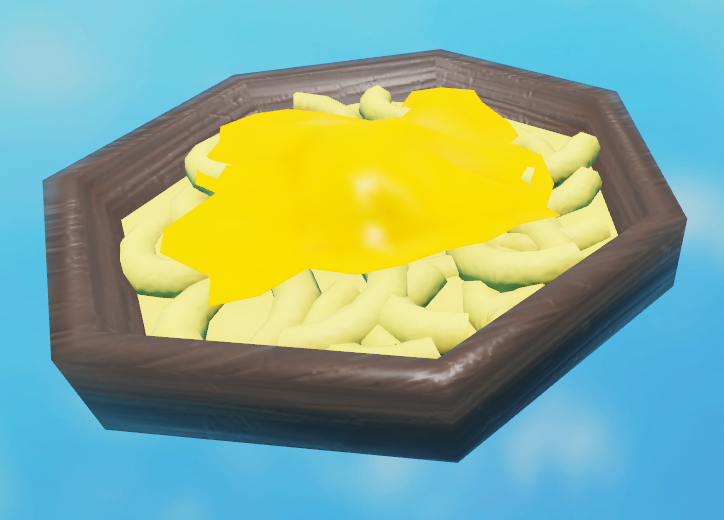
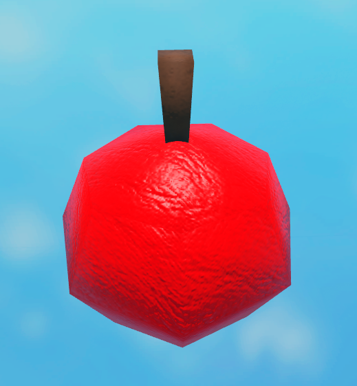
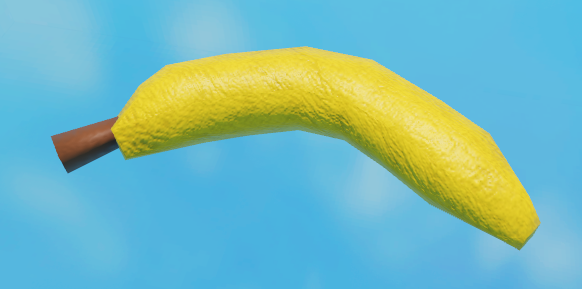
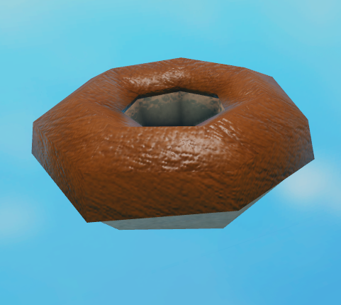
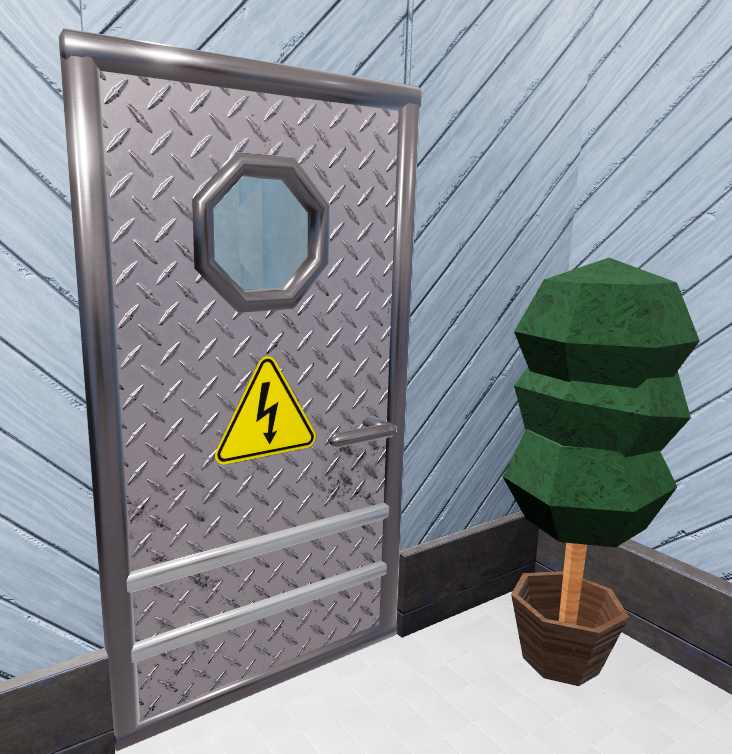
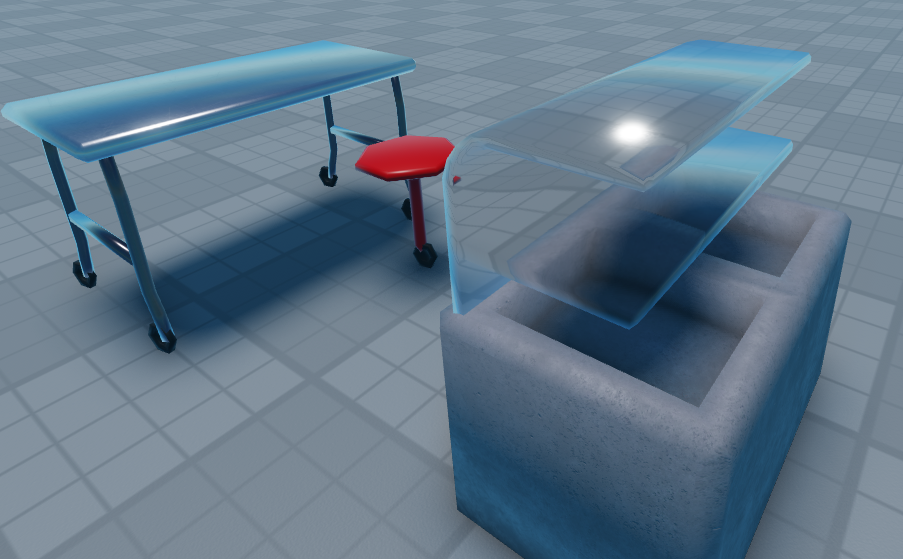
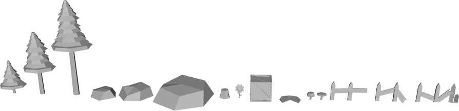

## Une sélection de mes créations sur Blockbench

Depuis ma découverte de Blender, j'ai arrêté d'utiliser Blockbench comme application principale pour concevoir mes modèles 3D.

Mais voici une sélection de modèles 3D stylisés en low poly que j'ai fait avant.

