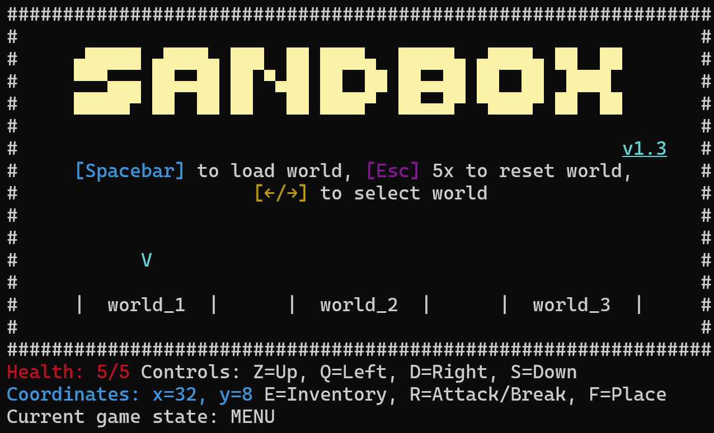
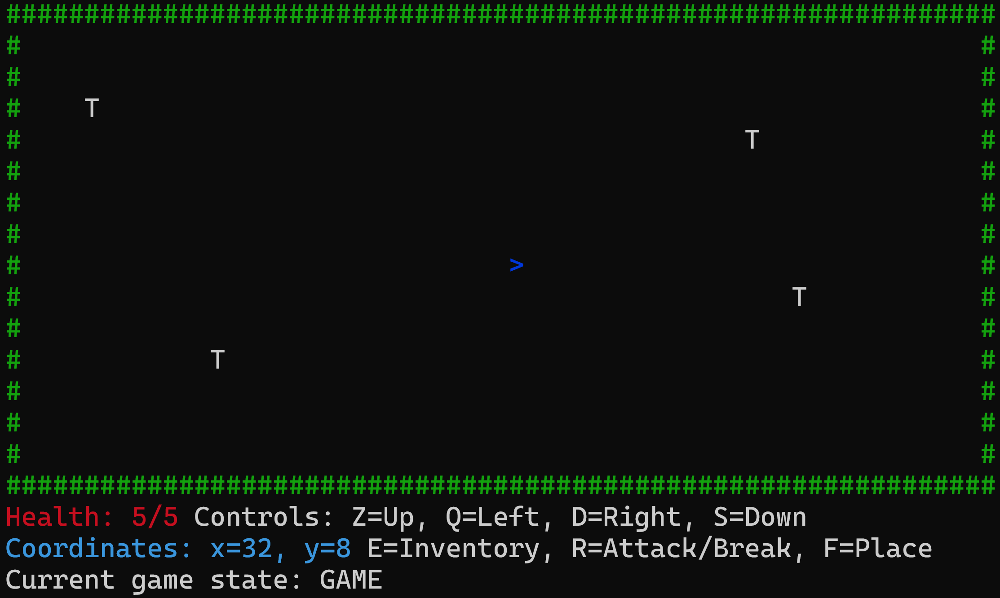
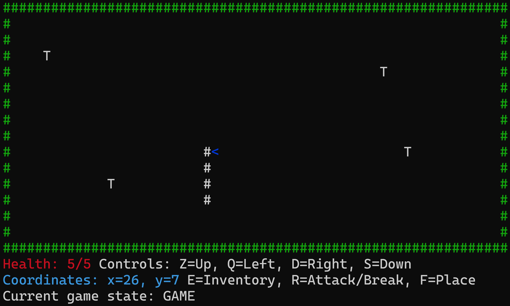
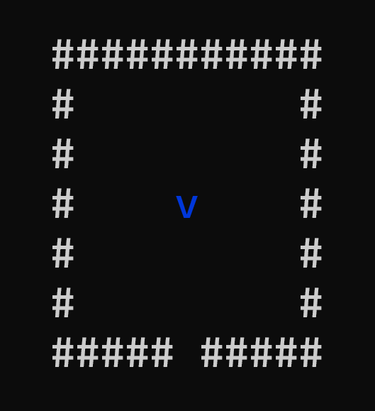
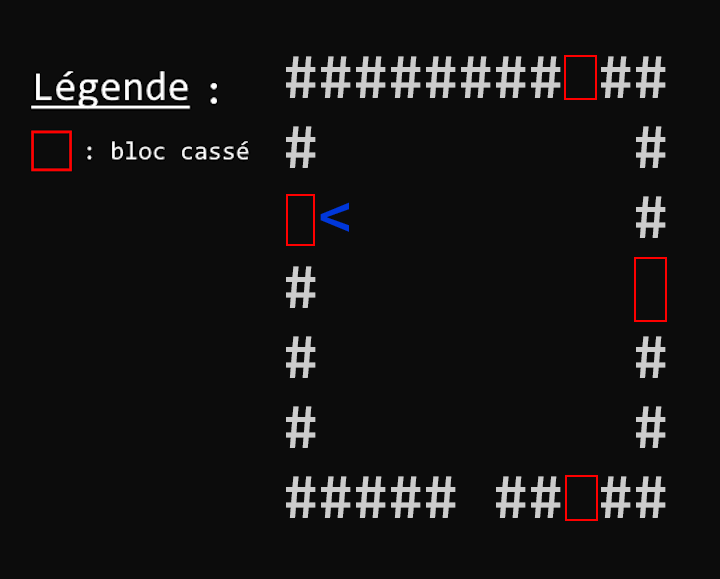

## ASCII Sandbox v1.3

C'est un de mes premiers projets en C++. Un jeu entièrement fonctionnel dans un terminal.

C'est un jeu très simple. Vous êtes disposés de 3 mondes. Vous pouvez en choisir un en appuyant sur `SPACE`, déplacer le curseur de sélection avec les flèches gauches ou droites du clavier (`<-`/`->`) et supprimer/réinitialiser un monde en appuyant 5 fois sur `ESC`. Ces mondes sont d'ailleurs rangés dans des fichiers en `.txt`, situés dans le dossier `saves`, et `world_0` représente le monde par défaut.

Chaque monde est fait de 32x16 caractères, entouré d'un cadre de dièses (`#`) incassables. Les contrôles sont :
- Z : monter
- Q : aller à gauche
- D : aller à droite
- S : reculer
- F : poser un bloc (`#`)
- R : détruire un bloc (`#`)

Chaque action actualise l'écran entier, donc si vous essayez de scroller vers le haut, vous verrez toutes vos actions précédentes.

Le jeu s'appelle ASCII Sandbox car il utilise des caractères ASCII dans un monde sandbox, un monde où la limite est la créativité du joueur.

Et vous pouvez donc casser des blocs, sauf les barrières de dièses (`#`) vertes.

Chaque action sauvegarde votre monde entier dans le fichier `.txt` correspondant au monde. Donc votre ne monde ne se supprimera pas tout seul.
